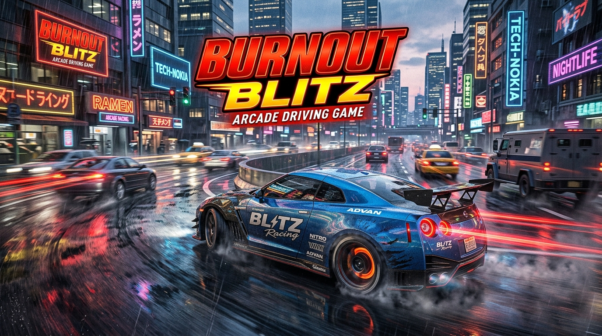
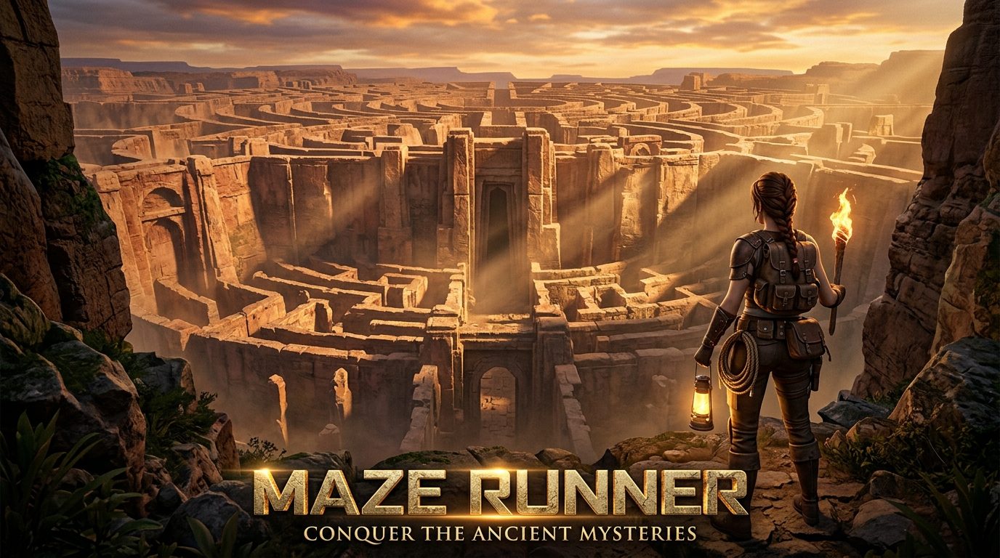
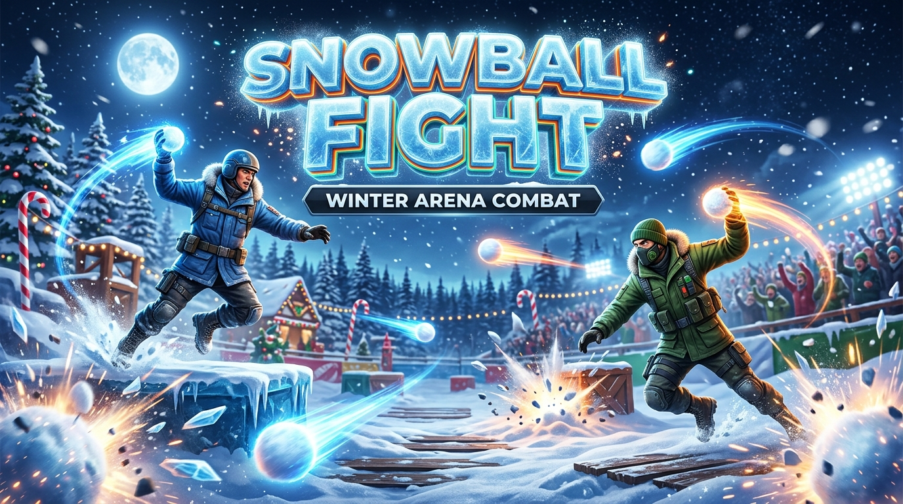
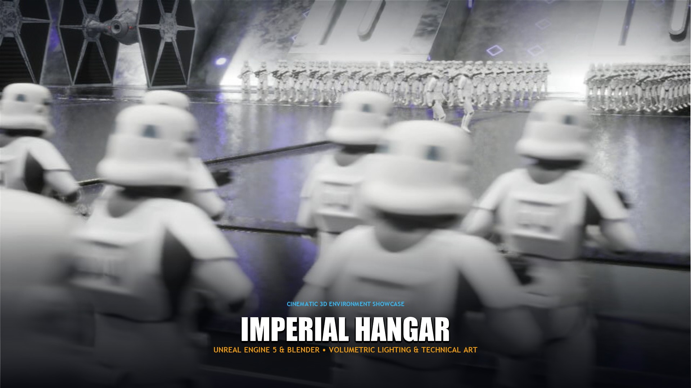

# Game Design Portfolio

> A showcase of game design, gameplay mechanics, level design, and interactive experiences by **Sanjai Sanakiyan**.

---

## 🎮 Live Demo & Repository

- **Live Portfolio Website:** [https://sanjaisanakiyan.github.io/Portfolio/](https://sanjaisanakiyan.github.io/Portfolio/)
- **GitHub Repository:** [https://github.com/sanjaisanakiyan/Portfolio](https://github.com/sanjaisanakiyan/Portfolio)

---

## 👨‍💻 About Me

I am a passionate and creative **Game Designer & Artist** with an academic background in **Computer Science Engineering with Specialization in Gaming Technology** from **SRM Institute of Science and Technology** (2021 – 2025).

My core design philosophy centers on a simple principle: **"I design experiences players remember."** I focus on analyzing player psychology, crafting tactile feedback, and orchestrating mechanics, level geometry, and visual storytelling into seamless flow states.

### Core Focus Areas
- **Gameplay Mechanics & Feel:** Designing intuitive controls, responsive feedback loops, and balanced moment-to-moment interactions.
- **Level Design & Spatial Navigation:** Building graybox blockouts, sightline orientation, and environmental wayfinding that guide players naturally without excessive hand-holding.
- **Game Prototyping & Systems:** Rapidly validating mechanics using whitebox geometry, state machines, and iterative playtesting.
- **Player Experience (UX/Pacing):** Evaluating player friction, tuning difficulty curves, and harmonizing lighting, camera work, and audio cues.

---

## 🔄 Design Methodology

My development approach follows a structured 5-step iterative pipeline prioritizing player feedback, rapid validation, and technical polish:

| Step | Phase | Focus & Execution |
| :--- | :--- | :--- |
| **01** | **IDEA** | Define gameplay concept, core fantasy, constraints, and player goals. |
| **02** | **PROTOTYPE** | Rapidly test mechanics, vehicle/character physics, and inputs using whitebox geometry. |
| **03** | **BUILD** | Develop gameplay systems, AI behaviors, environment layouts, UI, and state machines. |
| **04** | **TEST** | Playtest loops, identify player friction, debug edge cases, and refine pacing. |
| **05** | **POLISH** | Elevate lighting, particle VFX, camera framing, tactile feedback, and final presentation. |

---

## 🚀 Featured Projects

### 1. Burnout Blitz (Arcade Driving Prototype)
*A Unity-based arcade driving prototype featuring responsive third-person vehicle controls, dynamic AI traffic simulation, garage selection, and complete game loop state management.*

- **Role:** Game Development / Gameplay Systems
- **Engine & Tools:** Unity 3D / Unity 6 LTS, C#, Rigidbody & WheelColliders
- **Category:** Gameplay • Vehicle Systems • AI
- **Key Features & Mechanics:**
  - Responsive third-person chase camera with velocity-based FOV kick.
  - Tuned arcade handling model with custom lateral friction, acceleration curves, and braking grip.
  - Dynamic AI traffic simulation with waypoint pathing and raycast obstacle avoidance.
  - Real-time collision detection triggers on chassis colliders with burnout smoke VFX.
  - Garage-based multi-car selection system displaying vehicle telemetry and specs.
  - Structured gameplay state machine managing Start, Garage, Active Drive, Crash/Restart, and Exit states.
- **Project Links:**
  - 🌐 [Explore on Live Portfolio](https://sanjaisanakiyan.github.io/Portfolio/#projects)
  - 📂 [View Project Archive (Google Drive)](https://drive.google.com/drive/folders/1qHLftPa75w1miNfKX7r1I1uUfMXf8MWi?usp=sharing)

---

### 2. Third-Person Maze (Maze Runner Level Design)
*An Unreal Engine 5 third-person level-design prototype exploring spatial navigation through an earth-toned monolithic stone labyrinth with branching paths, strategic dead ends, and volumetric lighting landmarks.*

- **Role:** Game Design / Level Design
- **Engine & Tools:** Unreal Engine 5, Blueprints, Lumen GI, Exponential Height Fog
- **Category:** Level Design • Unreal Engine 5 • Spatial Navigation
- **Key Features & Mechanics:**
  - Mental mapping emphasis designed without minimaps or floating waypoints to reward organic spatial deduction.
  - 6-stage level design methodology: Research & Planning → Blockout/Graybox → Player & Camera Setup → Environment Development → Iteration & Debugging → Final Presentation.
  - Architectural corridor calibration (3.5m width, 4m height) and SpringArm camera boom (320 units) with collision probe filtering to prevent clipping.
  - Beveled 90-degree corridor corners to expand player sightlines before turning into intersections.
  - Dynamic Lumen global illumination and Directional Sun creating volumetric light shafts as natural navigational breadcrumbs.
  - Blueprint-driven environmental actors, trigger volumes, and simplified box collision meshes.
- **Project Links:**
  - 🌐 [Explore on Live Portfolio](https://sanjaisanakiyan.github.io/Portfolio/#projects)
  - 📂 [View Project Archive (Google Drive)](https://drive.google.com/drive/folders/1gvHnf9RfiTiL2Uh77j3hLagwYHZ1gF3A?usp=drive_link)

---

### 3. Snowball Fight (2D Arena Combat Prototype)
*A Unity 6 2D local multiplayer arena combat prototype focused on parabolic snowball projectile physics, precision platform traversal, and winter-themed visual feedback.*

- **Role:** Game Development / 2D Gameplay & Combat Mechanics
- **Engine & Tools:** Unity 6 LTS (6000.6.3f1), Universal Render Pipeline (URP), C#, 2D Physics
- **Category:** 2D Gameplay • Combat Physics • Multiplayer
- **Key Features & Mechanics:**
  - Physics-driven snowball projectile arcs with dedicated throw transforms, trigger colliders, and impact particle bursts.
  - Simultaneous 2-player local keyboard controls with balanced movement speed (10) and jump impulse (20).
  - Multi-tiered modular snow platform traversal supported by grounded raycast checks.
  - Custom 5-point candy-cane health tracking HUD with hurt audio triggers and victory banners.
  - Dynamic snowfall Shuriken particle system with wind drift turbulence and foreground depth.
  - Clean canvas state machine transitioning between Main Menu, Active Arena Duel, and Victory states.
- **Project Links:**
  - 🌐 [Explore on Live Portfolio](https://sanjaisanakiyan.github.io/Portfolio/#projects)
  - 📂 [View Project Archive (Google Drive)](https://drive.google.com/drive/folders/1QTZcfc8K9JQZpSMYd7RHCt46htROJFCq?usp=sharing)

---

### 4. Cinematic 3D Environment (Imperial Hangar)
*An environment art study and cinematic lighting showcase in Unreal Engine 5 and Blender, exploring industrial scale, volumetric atmosphere, and narrative environmental storytelling.*

- **Role:** Environment Artist & Lighting / Technical Presentation
- **Engine & Tools:** Unreal Engine 5, Blender, Lumen GI, Niagara VFX, Cine Camera Actor
- **Category:** Lighting • VFX • Cinematic Presentation
- **Key Features & Mechanics:**
  - Hard-surface modular geometry and spacecraft modeling developed in Blender.
  - Symmetrical industrial hangar composition highlighting scale, reflective floor surfaces, and suspended starcraft.
  - 4-pass breakdown workflow: Unlit Blockout → Primary Atmospheric Pass → Secondary Rim, Fills & VFX → Final Color Grading & Post-Processing.
  - Volumetric lighting shafts piercing roof apertures paired with Exponential Height Fog.
  - Synchronized Niagara particle emitters (industrial sparks, steam, ambient dust motes) and mechanical hydraulic animations.
  - UE5 Cine Camera Actor configured with 35mm sensor format, anamorphic aspect ratio, custom ACES tonemapping curve, and cinematic depth of field.
- **Project Links:**
  - 🌐 [Explore on Live Portfolio](https://sanjaisanakiyan.github.io/Portfolio/#projects)
  - 📂 [View Project Archive (Google Drive)](https://drive.google.com/drive/folders/1zGgl4j7DXApgY53wCyXXkQ_auMhkfxrR?usp=drive_link)

---

## 🛠️ Skills and Tools

### Technical Competencies

| Category | Skills & Technologies |
| :--- | :--- |
| **Game Engines** | Unity (2D/3D, Unity 6 LTS, Universal Render Pipeline, Physics), Unreal Engine 5 (Lumen, Niagara, Blueprints, Grayboxing) |
| **Programming & Scripting** | C# (Gameplay systems, state management, controller physics), C++ Basics (Core fundamentals, OOP) |
| **Game Design** | Gameplay Mechanics, Level Design (Grayboxing & Blockouts), Player Experience & Pacing, Game Prototyping, Systems Design, Testing & Balancing |
| **3D & Technical Art** | Blender (3D Hard-Surface Modeling, Mechanical Animation), Volumetric Lighting, Atmospheric Fog, Particle VFX (Niagara & Shuriken), Camera Composition |

---

## 💼 Professional Experience

### **Game Development Intern** — Pearl Lemon Limited
*UK \| Remote &bull; March 2026 – April 2026* &bull; [Verified Experience Letter (PDF)](assets/experience-letter.pdf)

- Assisted with game design and development processes across multiple project initiatives.
- Contributed to coding, debugging, and maintaining clean gameplay systems.
- Developed and refined interactive gameplay mechanics and player feedback loops.
- Supported testing, optimization, and bug fixing to improve project stability and performance.
- Collaborated with cross-functional development team members and aligned development tasks with project milestones.
- Adapted iteratively to team feedback, design reviews, and evolving technical requirements.

---

## 🎓 Education

### **Bachelor of Technology (B.Tech) in Computer Science Engineering**
**Specialization:** Gaming Technology  
**Institution:** SRM Institute of Science and Technology  
**Duration:** 2021 – 2025  

**Key Areas of Study:**
- Game Engine Architecture
- 3D Computer Graphics
- Physics Simulation
- Data Structures & Object-Oriented Programming (OOP)
- Interactive Media & Game Design Principles

---

## ✨ Portfolio Website Features

The live portfolio website hosted at [sanjaisanakiyan.github.io/Portfolio](https://sanjaisanakiyan.github.io/Portfolio/) includes the following built-in interactive features:

1. **Cinematic Dark Design System:** Tailored typography (Space Grotesk, Syne, JetBrains Mono), neon amber/cyan accents, and an ambient interactive canvas background.
2. **Dynamic Project Filtering:** Real-time client-side filtering across All Projects, Unity, Unreal Engine 5, Level Design, and 3D Art & VFX.
3. **Deep-Dive Case Study Modal System:** Reusable modal window offering multi-tab breakdowns for each project (*Overview & Role*, *Key Systems & Mechanics*, *Deep Dive & Iteration*, *Project Gallery*, *What I Learned*).
4. **Cinema-Grade Lightbox Viewer:** Fullscreen image modal supporting keyboard navigation (Left/Right arrow keys, Escape), swipe handling, and thumbnail navigation strips.
5. **Interactive 5-Step Methodology Stepper:** Visual timeline presenting the core game design and iterative production process.
6. **Web Audio API UI Synthesis:** Futuristic sci-fi micro-audio feedback generated procedurally via the browser's Web Audio API.
7. **Direct Inquiry & Clipboard Utility:** One-click email copy action with toast feedback, direct mailto launcher, and interactive message composer.
8. **Verified Experience Letter Access:** Direct viewable/downloadable PDF link for formal industry verification.

---

## 📬 Contact & Connect

I am actively seeking **Game Designer**, **Junior Game Designer**, and **Game Developer** opportunities. I am based in India and open to both remote roles and worldwide relocation.

- **Portfolio:** [https://sanjaisanakiyan.github.io/Portfolio/](https://sanjaisanakiyan.github.io/Portfolio/)
- **GitHub:** [https://github.com/sanjaisanakiyan](https://github.com/sanjaisanakiyan)
- **Email:** [sanjaisanakiyan007@gmail.com](mailto:sanjaisanakiyan007@gmail.com)
- **Location:** India / Remote &bull; Open to Worldwide Relocation
- **Project Archives:** [Google Drive Projects Collection](https://drive.google.com/drive/folders/1hACHV7x8eT5Bk8Hb8FWH9l03WzLV9dw-?usp=sharing)

---

## 🤝 Let's Build Something Playable

*Thank you for taking the time to review my work! Whether you're a studio director, lead designer, recruiter, or fellow developer, feel free to reach out to discuss game design, prototype mechanics, or potential opportunities.*
